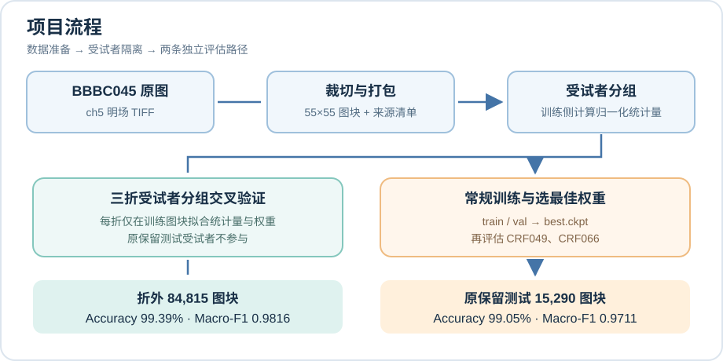
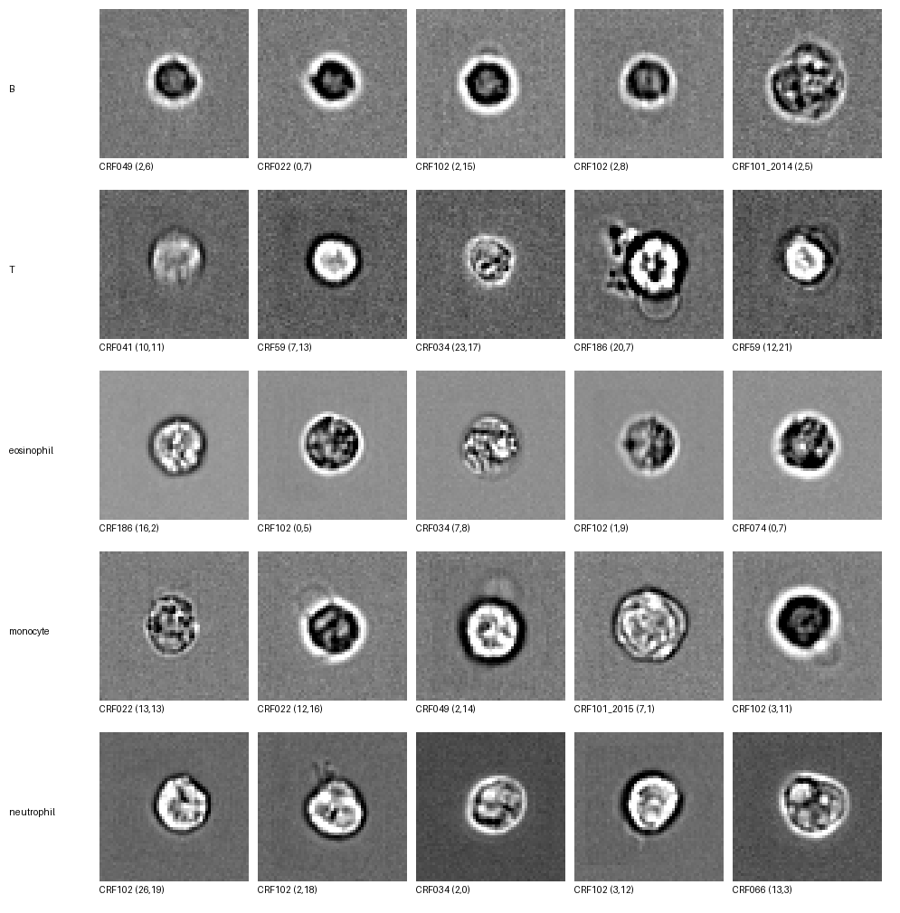
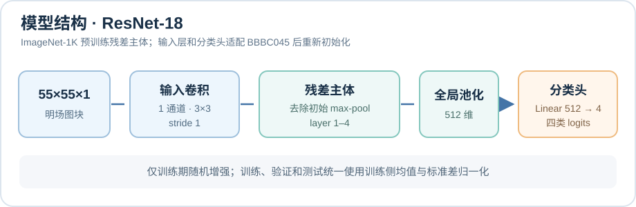
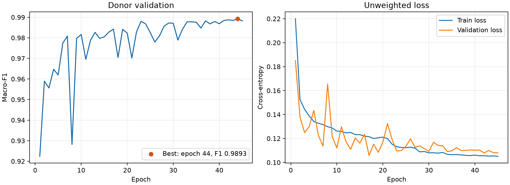
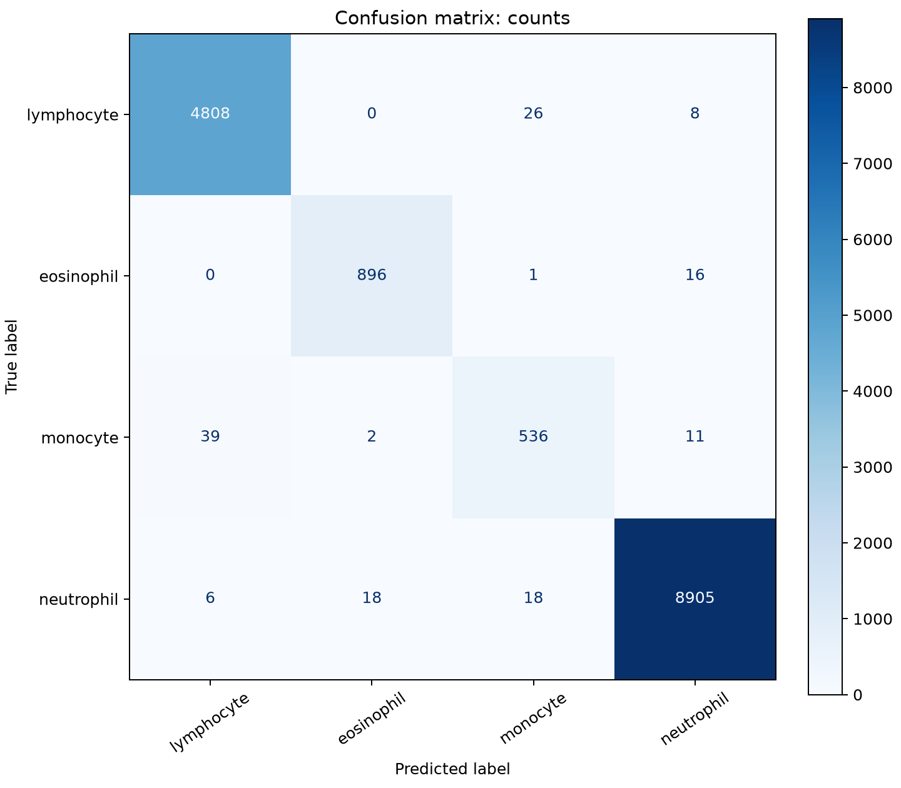

# Label-Free Leukocyte Analysis

基于 BBBC045 的 55×55 单通道明场图块，训练四类白细胞分类器：淋巴细胞（B＋T）、嗜酸性粒细胞、单核细胞和中性粒细胞。模型使用适配小图的 ResNet-18，从 ImageNet-1K 权重微调；按受试者划分数据，归一化统计量仅由相应训练侧计算。

## 主要结果与边界

| 评估方式 | 图块数 | Accuracy | Macro-F1 |
| --- | ---: | ---: | ---: |
| 三折受试者分组交叉验证的折外预测 | 84,815 | **99.39%** | **0.9816** |
| 常规训练模型在原保留测试受试者上的评估 | 15,290 | **99.05%** | **0.9711** |

两行来自不同训练与评估流程，不能当成同一模型在同一数据集上的前后提升。原保留测试集（CRF049、CRF066）已经用于多次事后分析，**不再是全新独立测试**；上述结果也不代表跨仪器泛化或临床性能。任务只对已裁切的四类细胞图块分类，未覆盖嗜碱性粒细胞，不能代替完整的五分类血常规。运行配置、每折结果和局限见[实验索引](docs/experiment_index.md)。

## 项目流程

<p align="center">
  
</p>

两条评估路径使用不同训练流程，不能将两组结果直接当作同一模型的前后提升。每折的归一化均值、标准差和类别权重仅由该折训练图块计算；常规训练也只用原训练集计算，不让验证或测试图块参与拟合。原始 B/T 标签保留在清单中，进入四分类模型时才合并。

下图是原始图块的缩略展示（按 B、T、嗜酸性粒、单核、中性粒细胞排列），不是模型预测结果。[点开查看完整尺寸](docs/assets/bbbc045_examples.png)。

<p align="center">
  <a href="docs/assets/bbbc045_examples.png"></a>
</p>

## 模型结构

<p align="center">
  
</p>

残差主体使用 ImageNet-1K 预训练权重；单通道输入层和四分类头重新初始化。增强**只作用于训练图块**，验证／测试沿用同一训练侧归一化参数，不做随机扰动。实现见[模型构建](src/leukocyte_analysis/models/resnet.py)和[数据加载](src/leukocyte_analysis/training/loaders.py)。

## 结果可视化

下图来自上表的**常规训练模型**：左侧为逐轮验证 macro-F1，右侧为训练／验证的未加权交叉熵。实际优化目标还包含类别权重和标签平滑，不能直接把它的数值与图中的 `val_loss` 比较；图中的 F1 **不是训练集 F1，也不是测试集曲线**。

<p align="center">
  <a href="docs/assets/training_curves.png"></a>
</p>

下图是同一模型在**原保留测试受试者** CRF049、CRF066 上的计数混淆矩阵，行是真实类别，列是预测类别。单核细胞召回率为 91.16%，仍是相对弱项；该测试集已经被多次分析，不能将图称为全新独立测试结果。

<p align="center">
  <a href="docs/assets/confusion_matrix_counts.png"></a>
</p>

两张结果图分别来自运行 `resnet18_four_imagenet_flips_photometric_geometric_plateau_ls0.05_20261014_145319` 的 `csv/metrics.csv` 和 `test_evaluation/`；原始运行目录不随 Git 发布。训练指标也可在运行目录的 TensorBoard 日志中查看；评估时的混淆矩阵由[绘图模块](src/leukocyte_analysis/evaluation/plots.py)生成。详细分折结果与亮度局限见[实验索引](docs/experiment_index.md)。

## 从零准备环境和数据

数据来源：[Broad Bioimage Benchmark Collection 的 BBBC045v1 官方页](https://bbbc.broadinstitute.org/BBBC045)。按官网推荐，引用本数据集时注明 “We used image set BBBC045v1, available from the Broad Bioimage Benchmark Collection [Ljosa et al., Nature Methods, 2012].” 本项目只读取官方 `BBBC045_Stained_Montages.zip` 中的 `ch5_*.tif` 明场 montage；不需要另一个 CIF 压缩包。原始目录名提供 B、T、嗜酸性粒、单核和中性粒细胞标签，模型读取时才将 B/T 合并为淋巴细胞。

普通读者可先用 Python 3.11 建立虚拟环境。下面是 Windows PowerShell 的 **CPU 安装示例**；Linux/macOS 的虚拟环境激活命令不同，PyTorch 的 CPU/GPU 安装命令应按[官方安装选择器](https://pytorch.org/get-started/locally/)选择。`pyproject.toml` 声明其余运行依赖；已有 CUDA 13.2 环境的作者可继续使用 `environment.yml`，无需为 CPU 重建。

```powershell
py -3.11 -m venv .venv
.\.venv\Scripts\Activate.ps1
python -m pip install --upgrade pip
python -m pip install torch torchvision --index-url https://download.pytorch.org/whl/cpu
python -m pip install -e .
python -m pip check
```

在[官方页](https://bbbc.broadinstitute.org/BBBC045)下载 `BBBC045_Stained_Montages.zip`，将压缩包保存在项目外，然后解压到被 Git 忽略的目录：

```powershell
$zip = Read-Host "请粘贴下载的 BBBC045_Stained_Montages.zip 完整路径"
Expand-Archive -LiteralPath $zip -DestinationPath .\data\raw
Get-ChildItem .\data\raw -Directory
```

数据根目录必须**直接**包含 `CRF022/` 等受试者目录；例如 `data/raw/Stained_Montages/CRF022/T/batch1/ch5_*.tif`。若解压后多出一层目录，请把 `--data-root` 指向实际含 `CRF*` 子目录的那一层。原图也可以放在项目外，本机现有路径是 `../Stained_Montages/`；`data/raw/` 和生成的 `data/processed/` 均被 Git 忽略。

在项目根目录按顺序生成原始清单、固定受试者 train/val/test 划分、55×55 图块包和**仅从 train 计算**的归一化统计量：

```powershell
python -m leukocyte_analysis.prepare_data --data-root .\data\raw\Stained_Montages
# 若已将原图解压在项目外，改用：
# python -m leukocyte_analysis.prepare_data --data-root ..\Stained_Montages
```

命令复用 `data/` 下已有的清单、划分、打包、抽查和统计模块，默认输出到 `data/processed/`。目标文件只要已有一个就会拒绝启动，不覆盖旧实验数据；需要另一份结果时使用 `--output-dir` 指向**新的**目录，并在常规训练命令中指定对应的 `--split-csv`、`--tiles-npy` 和 `--stats-json`。若运行中断，已完成的输出不会自动删除；核对后可选择新的输出目录重做。数据准备会读取和打包全部 TIFF，耗时且需数 GB 磁盘空间；本仓库不附带原图、处理数据或预训练权重。完成后按下一节先跑轻量测试，再启动训练。

## 快速运行

以下命令在项目根目录执行，以已按上一节准备好的 `data/processed/` 图块与清单、已激活的环境为前提。若尚未执行 `pip install -e .`，先设置源码路径；已执行者可以跳过第一行。先做轻量检查：

```powershell
$env:PYTHONPATH = (Resolve-Path .\src).Path
python -m unittest discover -s tests -v
python -m leukocyte_analysis.train --smoke-test --batch-size 8 --init random
```

默认值现已对齐各自最近一次完成的配置：常规训练最多 45 轮，三折交叉验证每折最多 30 轮；两者均用 ImageNet 初始化、学习率 `0.0001`、翻转／光度／几何增强、Plateau、标签平滑 `0.05`、早停耐心值 15 和最小改善量 0。直接运行 `python -m leukocyte_analysis.train` 或 `python -m leukocyte_analysis.cross_validate` 即采用这些默认值。下面显式写出完整命令，方便留存配置；每次运行会新建结果目录：

```powershell
python -m leukocyte_analysis.train `
  --init imagenet --lr 0.0001 --epochs 45 --batch-size 128 `
  --augmentation flips_photometric_geometric --lr-scheduler plateau `
  --early-stopping-patience 15 --early-stopping-min-delta 0 --label-smoothing 0.05

python -m leukocyte_analysis.cross_validate `
  --folds 3 --init imagenet --lr 0.0001 --epochs 30 --batch-size 128 `
  --augmentation flips_photometric_geometric --lr-scheduler plateau `
  --early-stopping-patience 15 --early-stopping-min-delta 0 --label-smoothing 0.05
```

轮数和学习率仍由用户选择，例如 `python -m leukocyte_analysis.train --epochs 60 --lr 0.00005`；其余参数不传时沿用上述默认值。`--epochs` 是最多训练轮数，早停仍可能提前结束。

后文保留默认参数、历史实验对照、检查点评估和诊断工具的详细说明。

## 目录

```text
environment.yml                 Conda 环境
pyproject.toml                  Python 包与命令行入口
src/leukocyte_analysis/
  prepare_data.py               原图到训练输入的准备入口
  data/                         数据读取、裁切、打包与审计代码
  models/                       模型结构代码
  training/                     数据加载器、Lightning 模块和实验配置
  evaluation/                   独立测试推理、指标和图像报告
  train.py                      命令行入口
  cross_validate.py             按受试者交叉验证入口
  resume_cv.py                  指定一折从 last.ckpt 续训入口
  evaluate.py                   训练完成后的测试集评估入口
  record_errors.py              从预测文件或检查点导出可定位的错分记录
  brightness_stress.py           已训练交叉验证权重的亮度敏感性诊断入口
  audit_brightness.py            原始图块的受试者／类别／批次亮度分布入口
data/raw/                       可选的原图解压目录（Git 忽略）
data/processed/                 已处理图块、清单、划分和训练集统计
data/pretrained/                官方预训练权重缓存（初次下载后复用）
reports/                        审计结果及预览图
runs/                           每次完整训练生成的权重和指标（初始不存在）
docs/                           实验记录及 README 用的少量静态图
tests/                          不依赖完整数据集的自动化测试
```

`src/leukocyte_analysis/data/` 存放**处理数据的代码**；项目根目录的 `data/` 存放**数据文件**。本机现有的原始 TIFF 仍在项目外的 `../Stained_Montages/`，没有复制或修改；其他读者可自行选择原图位置。

历史亮度诊断脚本依赖未发布的旧权重和数据，已从仓库移除；当时的数值与解释仍保留在[亮度实验汇总](docs/bbbc045_brightness_findings.md)。

## 当前数据

- `data/processed/bbbc045_tiles.npy`：100,105 个 55×55 明场图块；第 `i` 个图块对应清单第 `i` 行。
- `data/processed/bbbc045_manifest.csv`：图块来源、受试者、类别和网格位置。
- `data/processed/bbbc045_split.csv`：在清单基础上增加 train/val/test 划分。清单始终保留原始 B/T 标签；训练加载时才映射为四类，不需重新裁切或打包。
- `CRF101_2014` 和 `CRF101_2015` 共用 CRF101 编号；官方资料尚未明确核实是否同一人，因此保守地视作同一划分组。当前固定划分中两者均在训练集。今后的常规训练即使用自定义 `--split-csv`，启动前也会拒绝把它们分到不同的 train/val/test 侧；交叉验证同样保持同折。
- `data/processed/bbbc045_train_stats.json`：仅由训练集计算的归一化参数。
- `reports/bbbc045_audit.json`：此前的基础审计；`reports/bbbc045_audit_focus.json`：新版审计，以每类训练图块的清晰度代理分数第 1 百分位标记 train/val 低细节候选，不自动删除样本，也不能确认多细胞或错标；`reports/previews/`：预览图。

## 运行

在项目根目录激活 `label-free-leukocyte` 环境后，先做不保存权重的冒烟测试：

```powershell
$env:PYTHONPATH = (Resolve-Path .\src).Path
python -m leukocyte_analysis.train --smoke-test --batch-size 8 --init random
```

确认无误后运行当前默认配置的完整训练（最多 45 轮，可用参数覆盖）：

```powershell
python -m leukocyte_analysis.train
```

完整训练默认加载 torchvision 的 ImageNet-1K ResNet-18 权重，优先复用项目 `data/pretrained/` 中的缓存；缓存不存在时需要联网下载。若已设置 `TORCH_HOME`，则尊重该位置。单通道 3×3 首层按 Kaiming 方式初始化，四分类头使用 PyTorch 默认初始化，其他层保留预训练参数并全部参与微调。常规训练默认学习率为 `0.0001`，最多训练 45 轮，AdamW 的 `weight_decay=0.01`（不是 L1 正则化）。合并 B/T 后，类别权重由四类训练集数量重新计算，不沿用旧五分类权重。

默认 `--augmentation flips_photometric_geometric`：只对训练图块做随机水平／垂直翻转、随机 0°／90°／180°／270° 旋转，并以 50% 概率再做 ±15° 旋转、水平／垂直各最多 4%（55 像素图块约 2 像素）的平移及 0.95–1.05 倍缩放；小角度变换采用双线性插值，不做弹性形变。此前的 torchvision `ColorJitter` 仍对原始灰度施加 0.8–1.25 倍亮度、0.9–1.1 倍对比度；另以各 20% 概率使用轻微 3×3 高斯模糊（σ=0.2–0.6 像素）和高斯噪声（原始像素尺度 σ=0.00002），再按训练集均值和标准差归一化。验证与测试集不增强。旧增强保持原样：`--augmentation flips_photometric` 仅翻转加亮度／对比度，`--augmentation flips` 仅翻转。该组合配置已有三折和原保留测试集结果，但同时改变了多项训练设置，不能将成绩单独归因于某一种增强、学习率调度或标签平滑。默认 `--early-stopping-patience 15` 与 `--early-stopping-min-delta 0`：验证 macro-F1 连续 15 次检查未创新高就停止；耐心值设为 `0` 可禁用早停。余弦方案至少训练 15 轮（若总轮数不足 15 则训练到上限）。早停不保证提高最佳分数。训练循环、Rich 终端进度条、日志和检查点由 Lightning 管理；macro-F1 与各类召回率由 TorchMetrics 计算。每次训练新建 `runs/resnet18_four_初始化方式_增强方式_调度方式_时间戳/`，其中 `csv/metrics.csv` 是逐轮指标，`tensorboard/` 是曲线日志，`checkpoints/best.ckpt` 是按验证集 macro-F1 选出的权重。`last.ckpt` 是最近一次实际保存的检查点，可能与 `best.ckpt` 相同。测试集不参与训练或选择权重。
常规训练还会在该运行目录写入 `data_split.json`，记录所用清单、CRF101 合并分组规则、每组目录标识及 train/val/test 归属和图块数量；这只记录划分，不复制原始图像。

默认 `--lr-scheduler plateau`：验证 macro-F1 停滞时降低 AdamW 学习率，`patience=3`、`cooldown=2`、每次乘以 0.5，最低为初始学习率的 1%；与早停 `patience=15` 搭配，给降学习率后的模型留出观察时间。Lightning 每轮记录实际学习率。`--lr-scheduler cosine` 仍可选择：前 2 轮线性预热，随后按轮次余弦下降到初始值的 1%；`--lr-scheduler none` 可运行固定学习率对照，**不会叠加两种调度器**。标签平滑默认 `0.05`；可用 `--label-smoothing 0` 关闭，验证指标和 `val_loss` 不作平滑。`train_loss` 与 `train_weighted_loss` 保留未平滑口径用于旧实验对照，新增 `train_objective_loss` 显示实际优化目标。此前 Plateau 与余弦三折的折外指标十分接近，余弦并未显示稳定优势；当前命令行默认早停最小改善量为 0，与最近完成的组合配置一致。光度增强范围曾参考旧验证异常，因此同折比较属于探索性分析，不是全新独立测试。

当前只提供四分类训练与评估入口；旧五分类权重即使存在，也不能直接用于四分类。早停主要减少最佳验证轮次之后的无效训练，并不保证提高最佳分数。亮度审计、增强对照与压力测试的结果和解释统一见[亮度实验汇总](docs/bbbc045_brightness_findings.md)；测试错分及标签来源核查见[测试与标签异常记录](docs/bbbc045_test_audit.md)。

终端使用 Lightning 的 `RichProgressBar` 显示批次进度，并按实时窗口宽度逐级收起指标：窄窗口只保留轮次、横条和批次；中等宽度加入剩余时间及简短的 `loss`、`val_f1`；宽窗口再显示 `val_loss`。完整指标始终写入日志。极窄窗口或训练时频繁缩放仍可能造成显示残影。首次使用前，在已激活的环境中执行 `python -m pip install rich`；以后从更新后的 `environment.yml` 重建环境时会自动安装。训练时或训练后可另开终端运行：

```powershell
tensorboard --logdir .\runs
```

然后打开终端显示的本地地址（通常为 `http://localhost:6006/`）查看 `train_loss`、`val_loss`、`val_macro_f1`、各类 `val_recall_*` 和逐轮学习率 `lr-AdamW`。`train_loss` 和 `val_loss` 是未加权交叉熵；`train_weighted_loss` 是未平滑加权交叉熵。启用标签平滑后，实际更新参数的损失见 `train_objective_loss`，不要直接拿它的数值与未平滑的 `val_loss` 比较。指标每轮才更新一次，第一轮结束前不会出现曲线。按 `Ctrl+C` 可以中断；完整训练的检查点包含优化器状态，但当前命令行暂未提供断点续训参数，重新执行会新建运行目录。

若要进行随机初始化的对照实验，使用 `python -m leukocyte_analysis.train --init random`。也可通过 `--weight-decay` 显式改变权重衰减。冒烟测试命令使用随机初始化，以免仅为检查训练流程就下载预训练权重。

`environment.yml` 让 Lightning、TorchMetrics 等普通依赖由 pip 自行选择兼容版本；只固定 Python 3.14 和已验证可使用 GPU 的 PyTorch/torchvision CUDA 13.2 配对，以免重建环境时意外改为 CPU 版本。

## 按受试者交叉验证

交叉验证只使用原 train＋val 的 11 个目录标识，默认分为 3 折。`CRF101_2014` 与 `CRF101_2015` 共用 CRF101 编号；官方资料未明确核实两者是否同一人，因此**今后的分折保守地把两者视为同一组**（可用分组共 10 个），绝不分放训练和验证侧。每折从 ImageNet 权重重新初始化模型，并仅用该折训练图块重算像素均值、标准差和类别权重。CRF022 正常参与交叉验证；**CRF049 和 CRF066 继续保持原测试划分**，只是为了让下一次实验与旧折外基线可比，**不是将它们认定为坏数据或错标而筛除**。折内 CSV 保留全部原行及索引，但测试受试者标为 `excluded`，不会被训练或验证数据加载器读取。旧运行的 `plan.json` 和指标仍按原分折解释，不与新分折成绩直接作受控对比。

当前没有针对 `CRF049/monocyte` 的额外质量屏蔽规则；高错分率和亮度敏感性都不能证明官方标签错误。若今后决定改变受试者划分，可将 CRF049 作为一个完整受试者纳入新训练／验证方案，并从新的训练集重新计算归一化参数和类别权重；但那将是**新的数据划分**，不能与旧 11 人折外成绩直接比较，也不能再把已多次查看的 CRF049 当作未使用过的独立测试集。

先检查第一折的两批训练和验证（不保存权重）：

```powershell
python -m leukocyte_analysis.cross_validate --smoke-test --init random --batch-size 8
```

再运行按新 CRF101 同组规则分折的完整实验；每折默认最多 30 轮，耗时可能明显增加，不会由上述冒烟命令自动启动。若想复现最近完成的组合配置，命令如下；其他历史实验命令仍保留其当时的参数：

```powershell
python -m leukocyte_analysis.cross_validate --folds 3 --init imagenet --lr 0.0001 --epochs 30 --batch-size 128 --augmentation flips_photometric_geometric --lr-scheduler plateau --early-stopping-patience 15 --early-stopping-min-delta 0 --label-smoothing 0.05
```

标签平滑三折实验使用已验证过的翻转＋亮度／对比度方案，不叠加本次第 1 折未带来收益的几何／模糊／噪声增强；`--early-stopping-min-delta 0` 与此前同分折 Plateau 基线保持一致。系数 0.05 是比白细胞染色 RGB 图研究中常见的 0.1 更保守的起点，**不是 BBBC045 上已验证的最优值**：

```powershell
python -m leukocyte_analysis.cross_validate --folds 3 --init imagenet --lr 0.0001 --epochs 30 --batch-size 128 --augmentation flips_photometric --lr-scheduler plateau --early-stopping-patience 15 --early-stopping-min-delta 0 --label-smoothing 0.05
```

不加 `--first-fold-only` 就会一次运行完整三折；`plan.json` 和检查点会保存平滑系数。比较时以三折折外准确率、macro-F1、单核细胞 precision／recall 和各受试者指标为主，不把训练损失变大或预测置信度变低本身当作退步。原测试受试者 CRF049、CRF066 仍不参与本次参数选择。

最近完成的三折组合实验同时启用了统一 `0.05` 标签平滑与前述几何／模糊／噪声增强，命令如下；这也是当前三折入口的默认配置：

```powershell
python -m leukocyte_analysis.cross_validate --folds 3 --init imagenet --lr 0.0001 --epochs 30 --batch-size 128 --augmentation flips_photometric_geometric --lr-scheduler plateau --early-stopping-patience 15 --early-stopping-min-delta 0 --label-smoothing 0.05
```

这同时改变了增强和平滑两个因素，适合检验组合方案的总效果，但无法单独归因于其中一项。

若想先完整评估第 1 折，再决定是否训练剩余两折，在同一命令末尾加 `--first-fold-only`。完成后会输出第 1 折的准确率、macro-F1 与结果目录；这不是三折折外成绩。确定继续时，用它打印的目录运行 `python -m leukocyte_analysis.cross_validate --continue-run "结果目录"`：程序按保存的 `plan.json` 复用同一划分和训练配置，只训练第 2、3 折，最后生成完整 `summary.json`。不要改动第一折的目录或把 `--smoke-test` 当作完整训练；若某折训练中途被打断，程序不会覆盖该折已有文件。

如需在**同一新分折**下比较固定学习率，其他设置不变、仅关闭调度：

```powershell
python -m leukocyte_analysis.cross_validate --folds 3 --init imagenet --lr 0.0001 --epochs 30 --batch-size 128 --augmentation flips_photometric_geometric --lr-scheduler none
```

每次新建 `runs/cv_resnet18_.../`。`plan.json` 记录受试者分折，`fold_*/data/` 保存该折划分和训练集统计，`fold_*/training/` 保存日志及最佳检查点，`fold_*/validation_predictions.csv` 保存该折预测；`summary.json` 汇总折外准确率、macro-F1、各类指标和各受试者指标。这些验证结果用于比较训练方案；CRF049/CRF066 已经被查看过，不能再把它们当作新的独立最终测试。

若仅要检查本次 Plateau 实验中**第 2 折**是否被 20 轮上限截断，可从其 `last.ckpt` 续训到**总计最多 30 轮**；第 1、3 折不重跑，原运行目录保持不变：

```powershell
python -m leukocyte_analysis.resume_cv --source-run ".\runs\cv_resnet18_imagenet_flips_photometric_plateau_20261012_204944" --fold 2 --epochs 30
```

续训结果进入新建的 `runs/cv_fold02_extended_.../`：保留旧折预测，比较第 2 折旧／新最佳权重的验证 macro-F1，并重新汇总折外指标。`--epochs 30` 是总轮数上限，不是再加 30 轮；早停仍生效。由于 DataLoader 的独立随机生成器未保存在旧检查点，续训不保证与一次性训练 30 轮逐位一致。这个延长轮数的分析仍使用已反复查看的交叉验证数据，属于探索性比较。

两组交叉验证训练完成后，可用已有 `best.ckpt` 做**亮度压力测试**，不重新训练、不读取原测试受试者：

```powershell
python -m leukocyte_analysis.brightness_stress `
  --baseline-run .\runs\cv_resnet18_imagenet_flips_20261011_213201 `
  --augmented-run .\runs\cv_resnet18_imagenet_flips_photometric_20261012_111752 `
  --output-dir .\runs\brightness_stress_20261012
```

默认将每折验证图块的原始灰度值分别乘以 0.8、1.0、1.2，随后使用**该折训练集**统计量归一化；1.0 保持原始推理路径。工具会核对两次运行的受试者分折和其他训练参数一致，并拒绝把 CRF049/CRF066 纳入诊断。输出 `overall.csv`、`per_class_recall.csv`、`by_donor.csv`、两张曲线图和设置记录。报告目录必须不存在，避免覆盖既有结果。此测试只衡量既有验证集上的亮度敏感性：亮度区间和增强方案都曾参考验证异常，结果仍是**探索性证据**，不是全新独立测试；若 1.0 的指标与各次运行的 `summary.json` 明显不同，应先核对数据与检查点版本。

为判断 ±20% 扰动是否贴近实际采集差异，可先做**只读的真实亮度分布审计**。默认只统计交叉验证的 11 名受试者，不读取 CRF049/CRF066：

```powershell
python -m leukocyte_analysis.audit_brightness
```

若要把**原 train、val、test 三组全部纳入同一份描述性报告**，显式使用：

```powershell
python -m leukocyte_analysis.audit_brightness --include-test
```

默认分别新建 `reports/bbbc045_brightness_distribution/` 或 `reports/bbbc045_brightness_distribution_all_splits/`，互不覆盖。`tile_metrics.csv` 保存逐图块整图均值、外侧 5 像素环中位数和 P90−P10；`group_summary.csv` 按原划分／受试者／原始类别／batch 汇总，`split_summary.csv` 按原划分汇总，`within_donor_batch_pairs.csv` 给出同一受试者同一类别的批次比值，`largest_batch_shifts.png` 显示样本充足组中差异最大的批次。**边缘环中位数只是背景亮度代理**：细胞触边时也会受细胞影响；强度差异也可能来自细胞占图比例，不能单凭这些统计判定光照或标签错误。含测试集的输出仅用于事后排查，不改变原有 train/val/test 划分、图块或模型权重；已经查看过 CRF049/CRF066，不能用其统计结果挑选预处理后仍把它们称为全新独立测试集。

## 最终测试评估

先仅用训练/验证集确定实验配置和最佳模型，再用新四分类训练的 `best.ckpt` 对保留测试受试者评估一次。评估入口会拒绝旧五分类检查点：

```powershell
$checkpoint = Read-Host "请粘贴选定实验的 best.ckpt 完整路径"
python -m leukocyte_analysis.evaluate --checkpoint $checkpoint
```

测试集批量推理由 Lightning 的 `Trainer.predict()` 管理；分类指标和混淆矩阵交给 scikit-learn。默认在该实验目录下新建 `test_evaluation/`，生成 `test_metrics.json`、各类别 precision/recall/F1 的文本与 CSV 表、逐细胞预测 CSV、**仅含错分的 `test_misclassified.csv`**、计数及按真实类别归一化的混淆矩阵，以及每类最多三张高置信度错分示例图。错分 CSV 包含 `packed_index`、原始 TIFF 相对路径、受试者、网格行列、原始标签、模型预测与置信度；方便回到原图复核，不能直接当作错标证据。示例图的 1–99% 逐图对比度拉伸**只用于观看**，不影响推理。若报告目录已存在，命令会拒绝覆盖，避免误把多次测试当成独立验证。该测试集仅含两名保留受试者，指标不能替代跨设备、跨实验室的外部验证。

新的完整训练会用 Lightning 回调在 `validation_errors/epoch_000.csv` 等文件保存**每一轮**的验证错分；`validation_errors/frequency.csv` 统计同一 `packed_index` 错分的轮数、轮号和被判成的类别。轮号从 0 开始。冒烟测试不写这些文件。旧训练没有逐轮预测，无法事后恢复每轮错分；只能用其 `best.ckpt` 对验证集得到一份最佳权重的快照：

```powershell
$run = ".\runs\resnet18_four_imagenet_flips_20261011_143841"
python -m leukocyte_analysis.record_errors --split val --checkpoint "$run\checkpoints\best.ckpt" --output-csv "$run\validation_errors\best_misclassified.csv"
```

对于旧测试报告，不再次运行测试推理，而是从**已有**的预测 CSV 补出可定位的错分记录：

```powershell
python -m leukocyte_analysis.record_errors --split test --predictions-csv "$run\test_evaluation\test_predictions.csv" --output-csv "$run\test_evaluation\test_misclassified.csv"
```

记录程序拒绝覆盖已有目标文件；人工核查时不要根据测试集错分调整模型后再把同一测试集称为独立最终测试。

按“从零准备环境和数据”中的 `pip install -e .` 安装后，不必设置 `PYTHONPATH`；也可使用 `leukocyte-prepare-data`、`leukocyte-train`、`leukocyte-cross-validate`、`leukocyte-evaluate`、`leukocyte-record-errors`、`leukocyte-brightness-stress` 和 `leukocyte-audit-brightness` 命令。若沿用旧环境而只需注册命令，可执行 `python -m pip install --no-deps --no-build-isolation -e .`。

运行不依赖完整数据集的单元测试：

```powershell
$env:PYTHONPATH = (Resolve-Path .\src).Path
python -m unittest discover -s tests -v
```
