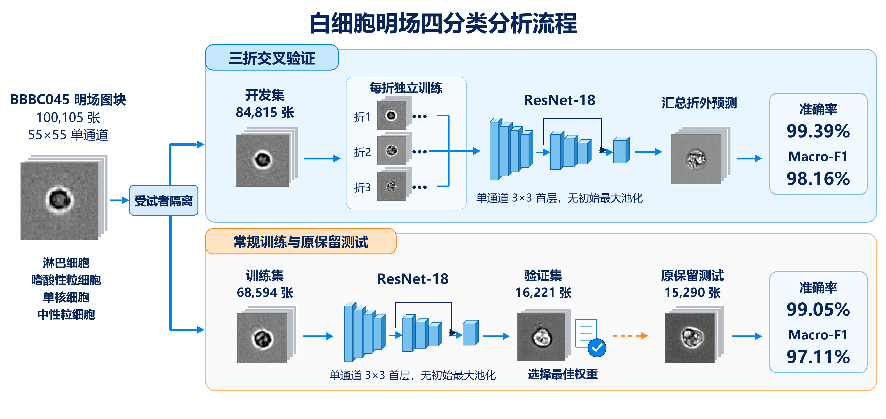
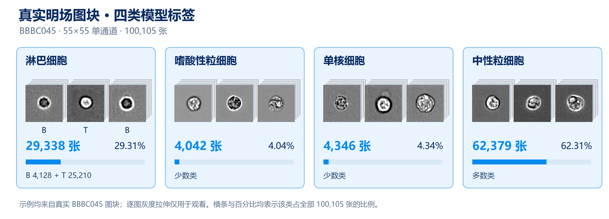
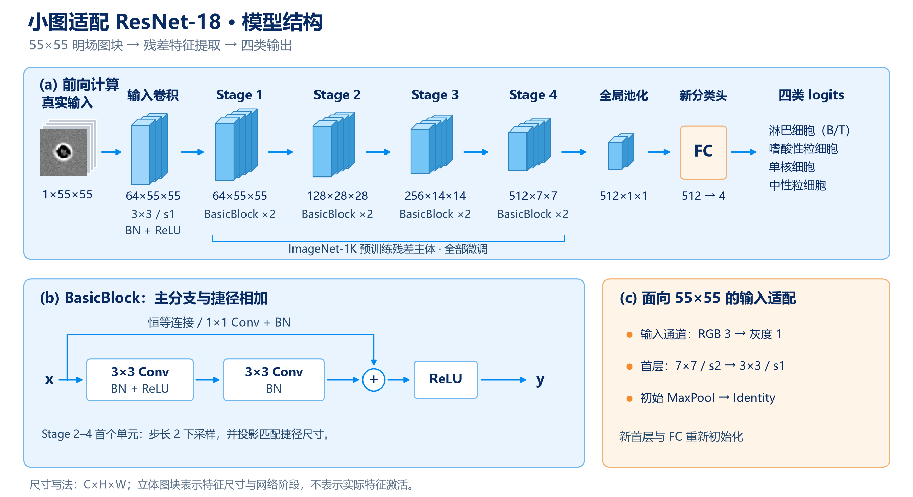
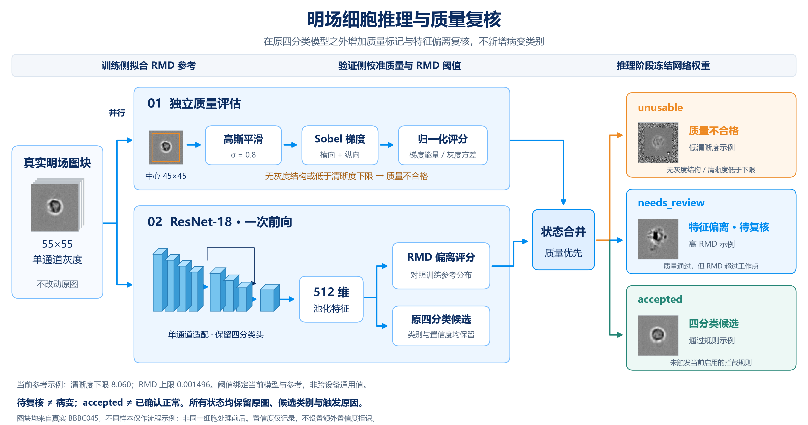
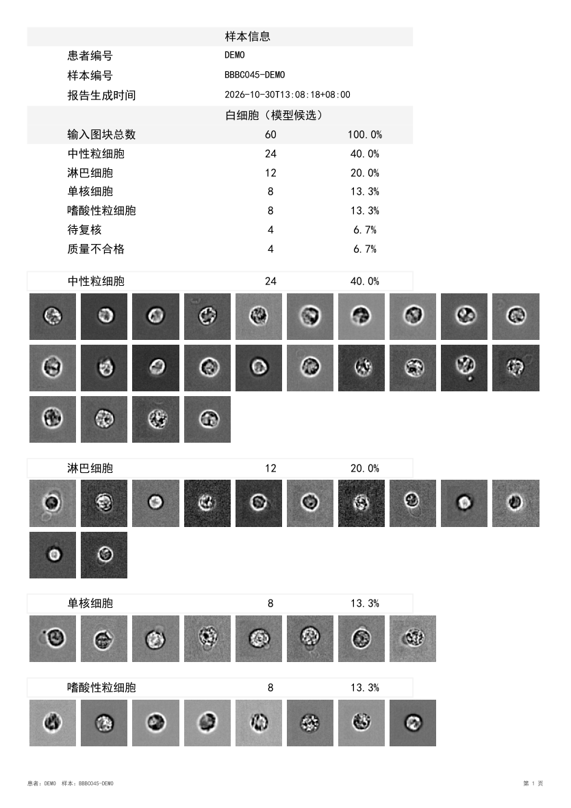
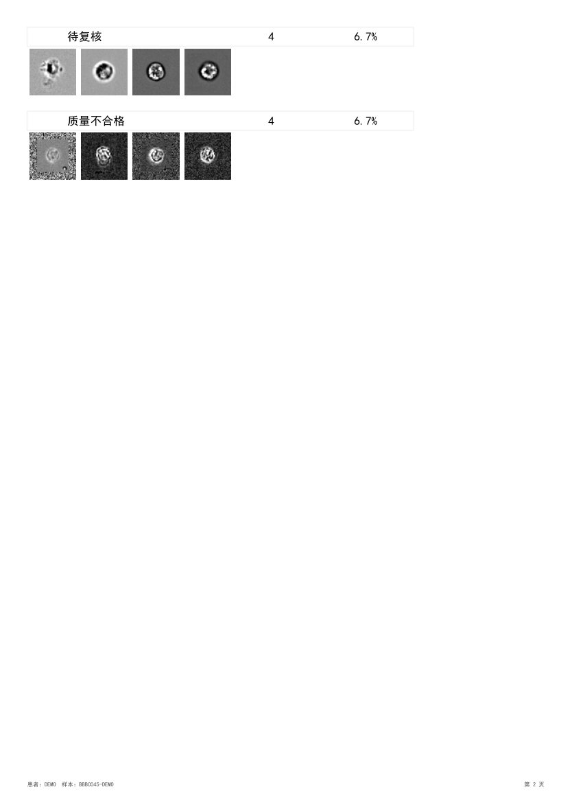

# Label-Free Leukocyte Analysis

基于 BBBC045 的 55×55 单通道明场图块，训练四类白细胞分类器：淋巴细胞（B＋T）、嗜酸性粒细胞、单核细胞和中性粒细胞。模型使用适配小图的 ResNet-18，从 ImageNet-1K 权重微调；按受试者划分数据，归一化统计量仅由相应训练侧计算。

[查看结果图](#结果可视化) · [模型结构](#模型结构) · [数据概览](#数据示例与类别分布) · [质量与待定复核](#图片质量与待定复核) · [PDF 样例](#患者级-pdf-结果报告) · [了解实现](#项目实现) · [运行代码](#快速运行) · [完整复现](#从零准备环境和数据)

## 主要结果与边界

| 评估方式 | 受试者范围 | 图块数 | Accuracy | Macro-F1 |
| --- | --- | ---: | ---: | ---: |
| 三折受试者分组交叉验证的折外预测 | 10 个分组 | 84,815 | **99.39%** | **0.9816** |
| 常规训练模型在原保留测试受试者上的评估 | CRF049、CRF066 | 15,290 | **99.05%** | **0.9711** |

两行来自不同训练与评估流程，不能当成同一模型在同一数据集上的前后提升。交叉验证的 10 个分组由 11 个目录标识组成，`CRF101_2014` 与 `CRF101_2015` 保守地放在同组。原保留测试集已经用于多次事后分析，**不再是全新独立测试**；上述结果也不代表跨仪器泛化或临床性能。任务只对已裁切的四类细胞图块分类，未覆盖嗜碱性粒细胞，不能代替完整的五分类血常规。运行配置、每折结果和局限见[实验索引](docs/experiment_index.md)。

## 结果可视化

下图来自上表的**常规训练模型**：左侧为逐轮验证 macro-F1，右侧为训练／验证的未加权交叉熵。检查点按第 44 轮的最高验证 macro-F1（0.9893）选择；右图标出**同一轮**的训练损失 0.1054 和验证损失 0.1081，并非各自曲线的最低值。实际优化目标还包含类别权重和标签平滑，不能直接把它的数值与图中的 `val_loss` 比较；图中的 F1 **不是训练集 F1，也不是测试集曲线**。

<p align="center">
  <a href="docs/assets/training_curves.png"></a>
</p>

下图是同一模型在**原保留测试受试者** CRF049、CRF066 上的混淆矩阵与每类召回率。左图行是真实类别、列是预测类别，数字为计数及行内比例，颜色按行内比例映射；右图突出各类召回率。单核细胞为 536/588 正确识别，召回率 91.16%，仍是相对弱项。该测试集已经被多次分析，不能将图称为全新独立测试结果。

<p align="center">
  <a href="docs/assets/confusion_matrix_counts.png"></a>
</p>

两张展示图根据运行 `resnet18_four_imagenet_flips_photometric_geometric_plateau_ls0.05_20261014_145319` 的原始 `csv/metrics.csv` 和 `test_evaluation/test_predictions.csv` 重新排版，曲线与计数保持原记录；原始运行目录不随 Git 发布。训练指标也可在 TensorBoard 中查看，评估入口的自动图表由[绘图模块](src/leukocyte_analysis/evaluation/plots.py)生成。详细分折结果与亮度局限见[实验索引](docs/experiment_index.md)。

## 项目实现

- 从 BBBC045 明场 montage 生成带来源索引的 55×55 图块、受试者划分与训练侧归一化统计量；原始 B/T 标签在四分类加载时合并。实现见[数据准备入口](src/leukocyte_analysis/prepare_data.py)。
- 将 ImageNet 预训练 ResNet-18 适配单通道小图，并在训练侧使用翻转、光度／几何增强、类别加权损失、标签平滑和学习率调度。实现见[模型](src/leukocyte_analysis/models/resnet.py)与[训练模块](src/leukocyte_analysis/training/module.py)。
- 提供按受试者分组的三折折外评估、原保留测试集混淆矩阵及可回溯原图的错分记录；亮度变化仅作事后敏感性诊断。入口见[交叉验证](src/leukocyte_analysis/cross_validate.py)与[测试评估](src/leukocyte_analysis/evaluate.py)。
- 在不改动分类权重的前提下，提供 RMD 特征待定与独立清晰度检查，并从已有结果导出患者级 PDF 总表、真实图册和逐图明细。入口见[细胞复核](src/leukocyte_analysis/review_cells.py)与[报告导出](src/leukocyte_analysis/patient_report.py)。

## 项目流程

<p align="center">
  <a href="docs/assets/workflow.png"></a>
</p>

[点开查看完整流程图](docs/assets/workflow.png)。图中 Macro-F1 的 98.16% 与 97.11% 分别对应正文的 0.9816 与 0.9711；网络图标为结构示意。两条路径使用不同训练流程，不能将两组结果当作同一模型的前后提升。每折的归一化均值、标准差和类别权重仅由该折训练图块计算；常规训练也只用原训练集计算，不让验证或测试图块参与拟合。原始 B/T 标签保留在清单中，进入四分类模型时才合并。

## 数据示例与类别分布

下图按四类模型标签展示真实图块及全数据集数量，淋巴细胞由原 B/T 标签合并。示例裁自已有的[完整图块展示图](docs/assets/bbbc045_examples.png)，逐图灰度拉伸仅用于观看，不参与训练或评估。数量差异也说明了同时报告 macro-F1 与逐类召回率的必要性。

<p align="center">
  <a href="docs/assets/cell_examples.png"></a>
</p>

## 模型结构

<p align="center">
  <a href="docs/assets/model_architecture.png"></a>
</p>

图中尺寸为 `C×H×W`，四个残差阶段分别输出 `64×55×55`、`128×28×28`、`256×14×14`、`512×7×7`，每阶段包含两个 BasicBlock；立体图块是结构示意。残差主体使用 ImageNet-1K 预训练权重，单通道输入卷积和四分类头重新初始化。增强**只作用于训练图块**，验证／测试沿用同一训练侧归一化参数。实现见[模型构建](src/leukocyte_analysis/models/resnet.py)和[数据加载](src/leukocyte_analysis/training/loaders.py)。

## 图片质量与待定复核

可选的图块复核入口复用原 ResNet 池化后的特征，通过 PyTorch-OOD 的 RMD 检查输入与已知四类的偏离程度；图片质量由拉普拉斯方差、Sobel 梯度能量与对比度归一化评分描述，当前清晰度拦截使用归一化 Sobel 评分。原四分类头和训练配置不变。

<p align="center">
  <a href="docs/assets/review_workflow.png"></a>
</p>

图示为**已启用质量参考**的复核流程：质量评分与网络特征分别计算，再按质量优先合并状态；质量不合格的图块也保留网络候选结果。细胞图片来自真实 BBBC045 图块，为不同样本示例，不是同一细胞处理前后。图中阈值仅对应当前模型与参考；**待复核不等于病变，规则通过也不等于已确认细胞正常**。

输出区分 `accepted`、`needs_review` 和 `unusable`，并保留原候选类别、分数和触发原因。RMD 只用训练侧拟合，完整验证侧校准已知误拒工作点；质量检查可复用验证评分校准保守下限，使每类校准图片的低清晰度拦截比例不超过 1%，显式传入质量参考后自动标记不合格，但不删除图片。该比例不是实测误判废率；未启用任何清晰度阈值时仅记录质量评分，常数图片仍会因缺少灰度结构标记为不合格。**尚未验证真实未知细胞及严重失焦的检出能力**。安装、拟合和应用见[特征与质量复核](docs/reproduction.md#特征与质量复核)。

分布偏离判断只使用 **RMD 特征偏离**，图片清晰度独立检查，也可触发质量存疑或不合格状态；分类置信度保留在报告中供查看，不按其设置另一套拒识规则。

| 输出状态 | 含义与处理 |
| --- | --- |
| `unusable` | 无灰度结构，或低于启用的清晰度下限；标记质量不合格，保留原图及候选类别。 |
| `needs_review` | RMD 超过参考工作点，或触发可选质量存疑规则；标记待复核，不直接判断病变或细胞类型。 |
| `accepted` | 未触发所启用的拦截规则，输出四分类候选；不代表已确认细胞正常。 |

复核功能通过独立的 `leukocyte-review-cells predict` 命令启用，不改变原训练、四分类评估或模型权重。使用质量参考才启用低清晰度判废；RMD 待定不是新增的训练类别，也不是病变诊断功能。

## 患者级 PDF 结果报告

**[查看演示 PDF（2 页，约 294 KiB）](docs/assets/patient_report_demo.pdf)**

样例从 BBBC045 公开数据中按展示配额选取 60 张真实图块，复用已有模型评分：四类候选 52 张、待复核 4 张、质量不合格 4 张。编号统一为 `DEMO`，不包含实际患者信息；样例比例仅用于展示版式，不代表自然细胞分布或性能评估。

<p align="center">
  <a href="docs/assets/patient_report_demo.pdf"></a>
</p>

<details>
<summary>查看第 2 页：待复核与质量不合格图块</summary>

<p align="center">
  <a href="docs/assets/patient_report_demo.pdf"></a>
</p>

</details>

已有复核结果可导出为**每位患者一份 PDF**：先列样本信息及总表，再逐类显示“名称／数量／占比”和十列真实图块图册，自动续页；同一患者的不同样本分开统计。逐图索引、原候选、分数及触发原因保存在同目录 `cell_details.csv`，方便回查。

导出不重新推理；需提供图块到脱敏患者／样本编号的完整 CSV，并核对原图块包摘要。PDF 总表与类别栏统一以**该样本全部输入图块**为分母，六项互斥计数合计为输入总数；原 `accepted` 内部比例另保留在 JSON。报告不输出临床高低标记、血液绝对浓度或未训练的病变／红细胞／血小板结论。安装可选依赖 `python -m pip install -e ".[pdf]"` 后，使用 `python -m leukocyte_analysis.patient_report`；完整输入格式与命令见[患者 PDF 导出](docs/reproduction.md#患者-pdf-导出)。

## 从零准备环境和数据

数据来源：[Broad Bioimage Benchmark Collection 的 BBBC045v1 官方页](https://bbbc.broadinstitute.org/BBBC045)。按官网推荐，引用本数据集时注明 “We used image set BBBC045v1, available from the Broad Bioimage Benchmark Collection [Ljosa et al., Nature Methods, 2012].” 本项目只读取官方 `BBBC045_Stained_Montages.zip` 中的 `ch5_*.tif` 明场 montage；不需要另一个 CIF 压缩包。原始目录名提供 B、T、嗜酸性粒、单核和中性粒细胞标签，模型读取时才将 B/T 合并为淋巴细胞。

普通读者可先用 Python 3.11 建立虚拟环境。下面是 Windows PowerShell 的 **CPU 安装示例**；Linux/macOS 的虚拟环境激活命令不同，PyTorch 的 CPU/GPU 安装命令应按[官方安装选择器](https://pytorch.org/get-started/locally/)选择。`pyproject.toml` 声明其余运行依赖；已有 CUDA 13.2 环境的作者可继续使用 `environment.yml`，无需为 CPU 重建。

```powershell
py -3.11 -m venv .venv
.\.venv\Scripts\Activate.ps1
python -m pip install --upgrade pip
python -m pip install torch torchvision --index-url https://download.pytorch.org/whl/cpu
python -m pip install -e .
python -m pip check
```

在[官方页](https://bbbc.broadinstitute.org/BBBC045)下载 `BBBC045_Stained_Montages.zip`，将压缩包保存在项目外，然后解压到被 Git 忽略的目录：

```powershell
$zip = Read-Host "请粘贴下载的 BBBC045_Stained_Montages.zip 完整路径"
Expand-Archive -LiteralPath $zip -DestinationPath .\data\raw
Get-ChildItem .\data\raw -Directory
```

数据根目录必须**直接**包含 `CRF022/` 等受试者目录；例如 `data/raw/Stained_Montages/CRF022/T/batch1/ch5_*.tif`。若解压后多出一层目录，请把 `--data-root` 指向实际含 `CRF*` 子目录的那一层。原图也可以放在项目外，本机现有路径是 `../Stained_Montages/`；`data/raw/` 和生成的 `data/processed/` 均被 Git 忽略。

在项目根目录按顺序生成原始清单、固定受试者 train/val/test 划分、55×55 图块包和**仅从 train 计算**的归一化统计量：

```powershell
python -m leukocyte_analysis.prepare_data --data-root .\data\raw\Stained_Montages
# 若已将原图解压在项目外，改用：
# python -m leukocyte_analysis.prepare_data --data-root ..\Stained_Montages
```

命令复用 `data/` 下已有的清单、划分、打包、抽查和统计模块，默认输出到 `data/processed/`。目标文件只要已有一个就会拒绝启动，不覆盖旧实验数据；需要另一份结果时使用 `--output-dir` 指向**新的**目录，并在常规训练命令中指定对应的 `--split-csv`、`--tiles-npy` 和 `--stats-json`。图块旁的 `.meta.json` 须随 `.npy` 一起保留。若运行中断，已完成的输出不会自动删除；核对后可选择新的输出目录重做。数据准备会读取和打包全部 TIFF，耗时且需数 GB 磁盘空间；本仓库不附带原图、处理数据或预训练权重。完成后按下一节先跑轻量测试，再启动训练。

## 快速运行

以下命令均从项目根目录执行。**不下载 BBBC045 数据**也可先运行单元测试，检查代码接口；通过不等于复现上表的模型成绩。若尚未执行 `pip install -e .`，先设置源码路径；已安装者可跳过第一行。

```powershell
$env:PYTHONPATH = (Resolve-Path .\src).Path
python -m unittest discover -s tests -v
```

准备好 `data/processed/` 图块与清单后，可用两批数据做训练入口冒烟测试（不保存完整模型）：

```powershell
python -m leukocyte_analysis.train --smoke-test --batch-size 8 --init random
```

确认数据与环境无误后再启动完整训练；以下命令**耗时且会写入 `runs/`**。默认值对齐最近完成的配置：常规训练最多 45 轮，三折交叉验证每折最多 30 轮；两者均用 ImageNet 初始化、学习率 `0.0001`、翻转／光度／几何增强、Plateau、标签平滑 `0.05`、早停耐心值 15 和最小改善量 0。

```powershell
python -m leukocyte_analysis.train
python -m leukocyte_analysis.cross_validate
```

轮数和学习率仍可指定，例如 `python -m leukocyte_analysis.train --epochs 60 --lr 0.00005`；`--epochs` 是上限，早停可能提前结束。显式参数、检查点评估和历史诊断命令见[运行与诊断指南](docs/reproduction.md)。

## 目录

```text
environment.yml                 Conda 环境
pyproject.toml                  Python 包与命令行入口
src/leukocyte_analysis/
  prepare_data.py               原图到训练输入的准备入口
  data/                         数据读取、裁切、打包与审计代码
  models/                       模型结构代码
  training/                     数据加载器、Lightning 模块和实验配置
  evaluation/                   分类评估、质量／特征复核与 PDF 报告
  reporting.py                  数据、训练及评估共用的报告发布与 CSV 工具
  paths.py                      共用项目位置和运行路径解析，不依赖训练配置
  train.py                      命令行入口
  cross_validate.py             按受试者交叉验证入口
  resume_cv.py                  指定一折从 last.ckpt 续训入口
  evaluate.py                   训练完成后的测试集评估入口
  record_errors.py              从预测文件或检查点导出可定位的错分记录
  review_cells.py               特征参考拟合与原始灰度图块的质量／待定复核
  patient_report.py              从已有复核结果导出患者级 PDF，不重新推理
  brightness_stress.py           已训练交叉验证权重的亮度敏感性诊断入口
  audit_brightness.py            原始图块的受试者／类别／批次亮度分布入口
data/raw/                       可选的原图解压目录（Git 忽略）
data/processed/                 已处理图块、清单、划分和训练集统计
data/pretrained/                官方预训练权重缓存（初次下载后复用）
reports/                        审计结果及预览图
runs/                           每次完整训练生成的权重和指标（初始不存在）
docs/                           运行指南、实验附录及公开展示图片／演示 PDF
tests/                          不依赖完整数据集的自动化测试
```

`src/leukocyte_analysis/data/` 存放**处理数据的代码**；项目根目录的 `data/` 存放**数据文件**。本机现有的原始 TIFF 仍在项目外的 `../Stained_Montages/`，没有复制或修改；其他读者可自行选择原图位置。

历史亮度诊断脚本依赖未发布的旧权重和数据，已从仓库移除；当时的数值与解释仍保留在[数据异常与诊断记录](docs/bbbc045_diagnostics.md)。

## 详细运行与诊断

数据文件说明、完整参数、交叉验证、亮度审计及测试评估命令见[运行与诊断指南](docs/reproduction.md)；每次实验的结果与边界见[实验索引](docs/experiment_index.md)。
